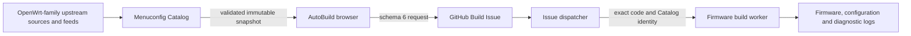

# Project Architecture

**Languages:** **English** · [简中](ARCHITECTURE.zh-CN.md) · 繁中 · Русский · Español · Português · 日本語 · 한국어 · Deutsch · Français · Tiếng Việt

<details>
<summary>🔤 More languages</summary>

<div dir="ltr">
Asturianu &lrm;·&lrm; Azərbaycanca &lrm;·&lrm; Беларуская &lrm;·&lrm; Български &lrm;·&lrm; বাংলা &lrm;·&lrm; বাংলা (বাংলাদেশ) &lrm;·&lrm; Català &lrm;·&lrm; Čeština &lrm;·&lrm; Dansk &lrm;·&lrm; Ελληνικά &lrm;·&lrm; Suomi &lrm;·&lrm; Filipino &lrm;·&lrm; Gaeilge &lrm;·&lrm; हिन्दी &lrm;·&lrm; Magyar &lrm;·&lrm; Bahasa Indonesia &lrm;·&lrm; Italiano &lrm;·&lrm; ქართული &lrm;·&lrm; ລາວ &lrm;·&lrm; Lietuvių &lrm;·&lrm; Latviešu &lrm;·&lrm; മലയാളം &lrm;·&lrm; मराठी &lrm;·&lrm; Bahasa Melayu &lrm;·&lrm; Norsk bokmål &lrm;·&lrm; Nederlands &lrm;·&lrm; Polski &lrm;·&lrm; Português (Brasil) &lrm;·&lrm; Română &lrm;·&lrm; Slovenčina &lrm;·&lrm; Svenska &lrm;·&lrm; தமிழ் &lrm;·&lrm; Türkçe &lrm;·&lrm; Українська &lrm;·&lrm; Màaya t'aan &lrm;·&lrm; &#x2067;العربية&#x2069; &lrm;·&lrm; &#x2067;فارسی&#x2069; &lrm;·&lrm; &#x2067;עברית&#x2069; &lrm;·&lrm; &#x2067;اردو&#x2069;
</div>

</details>

Wei.G OpenWrt AutoBuild is a static firmware customizer backed by GitHub Actions. The browser uses [Menuconfig Catalog](https://github.com/weigefenxiang/WeiG-OpenWrt-Menuconfig-Catalog) as its source of truth for upstream targets, native Kconfig state, packages and compatibility evidence. The build worker reconstructs the selected configuration against a pinned snapshot and executes the upstream build.

## 1. System boundaries



**Menuconfig Catalog owns the data.** It discovers Source/Branch combinations, captures native Target/Profile baselines, Kconfig symbols and typed relationships, and publishes curated application views, installed-size observations and scoped compatibility evidence. Its immutable assets, checksums and provenance identify the precise facts consumed by the browser and build.

**AutoBuild owns the workflow.** It presents the Catalog data, applies the shared native Kconfig evaluator to explicit user choices, previews compatible recommendations, exports the build request and dispatches it to the worker. AutoBuild must not maintain a second device matrix, package database, seed-config catalog or source-specific dependency engine.

**The firmware worker executes rather than second-guesses.** It validates the request and pinned inputs, reconstructs the native Profile baseline plus semantic overrides, checks effective explicit overrides, and runs upstream build commands. Browser compatibility recommendations and an explicit decision to continue with risk are not silently overruled by an extra worker-side package compatibility gate. Refer to [Runtime configuration contract](../../docs/RUNTIME-CONFIG-CONTRACT.md).

## 2. Repository layout

```text
WeiG-OpenWrt-AutoBuild/
├── .github/workflows/               build routing, worker, CI, cancellation, publishing
├── Shell/                           upstream build adapters
├── config/build.json                build-side configuration (never deployed as web assets)
├── config/build.schema.json
├── docs/
│   ├── DEVELOPER.md                 English developer guide
│   ├── DEVELOPER.zh-CN.md           Chinese developer guide
│   └── RUNTIME-CONFIG-CONTRACT.md   execution and configuration invariants
├── translations/
│   ├── README.zh-CN.md              Chinese project README
│   └── ARCHITECTURE/
│       ├── ARCHITECTURE.md          this English architecture guide
│       └── ARCHITECTURE.zh-CN.md    Chinese architecture guide
├── site/wrt/
│   ├── config/site.json             public site and firmware defaults
│   ├── index.html                   static UI
│   ├── app.js                       browser entry point
│   ├── lib/                         Catalog loading, Kconfig, UI and build controllers
│   └── data/                        generated translations and deployment identities
├── tools/                           validation, request and deployment utilities
└── VERSION                          code-behavior version
```

The actual source tree under `site/wrt/lib/` is modular; the diagram groups modules by responsibility rather than listing every file.

## 3. Configuration and deployment

There are two separate configuration authorities.

| File | Responsibility | Boundary |
| --- | --- | --- |
| `site/wrt/config/site.json` | Branding, Catalog location, Source/Branch preferences, loading policy, interface defaults, public firmware defaults | Safe to deploy with the web app; never stores secrets or duplicates Catalog facts |
| `config/build.json` | Password mode, compilation/download concurrency and public-build admission policy | Build side only; never shipped to a browser |

Secrets must not be put in public site files, generated build requests, Issues or logs. Build password handling and repository Secrets belong on the trusted execution side.

Chinese is the semantic reference. English text and stable keys live in `tools/i18n-source.json`, locale sources in `tools/i18n-translations/<locale>.json`, and shared metadata in `tools/i18n-locales.json`. `site/wrt/data/i18n/` contains only the generated manifest and independent gzip language bundles. The browser loads them on demand; website strings are not copied into Catalog or maintained as another translation authority.

The complete `site/wrt/` directory may be served by a static host. Submission is allowed only when the deployed release metadata matches the expected branch, commit and site identity. For exact-commit deployment, use the existing tool after committing the configuration and generated outputs:

```powershell
node tools/prepare-web-deployment.mjs --commit <40-character SHA> --branch <dev-or-main>
```

## 4. Catalog snapshots and release channels

AutoBuild code and Catalog runtime data have independent lifecycles. A code change alone does not require regenerating or promoting Catalog data.

| AutoBuild code | Default Catalog runtime |
| --- | --- |
| `fix-*` | Verified `catalog-dev` snapshot, unless another validated snapshot is explicitly selected |
| `dev` | `catalog-dev` |
| `staging` | `catalog-staging` |
| `main` | `catalog-main` |

A published Catalog channel resolves to an immutable `assetRef`. The browser verifies provenance, manifest identity, lengths and hashes; the request carries the matching pinned Catalog contract. Worker execution must not substitute a newer or different snapshot.

`catalog-candidate` is used during Catalog production promotion, **not** as a browser runtime source. When the runtime data surface has not changed and an immutable snapshot is still valid, channel publication reuses that same asset. Source discovery, typed Kconfig, targets, profiles, dependencies and compatibility are Catalog-owned data, not tables copied into AutoBuild.

## 5. Browser selection and preflight

The user selects **Source → Branch → Target System → Subtarget → Target Profile**, then customizes curated applications or **Advanced menuconfig**.

- Native Kconfig symbol types, defaults, visibility, choices, dependencies and `select`/`imply` behavior are evaluated through the shared Catalog model. Explicit intent is kept distinct from automatically derived effects.
- The browser can load an existing `build-request.json`, `.config` or `config.buildinfo`, but a fresh build must be exported from the current validated selection.
- Selecting packages or importing a configuration does not automatically open compatibility recommendations. Explicit **Test** and generation of the build request run the relevant consistency and scoped compatibility preflight.
- Recommendations operate on the actual current selection; the user may apply a plan or explicitly **retain and force continue**. This preserves intent, not a guarantee that upstream compilation will succeed.
- Package-size information is an estimate tied to exact architecture and native package versions. Unknown coverage is not treated as zero. Application-count and capacity warnings are advisory, not build gates.

## 6. Build request and firmware worker

The generated JSON request uses **schema 6**. It pins the AutoBuild code revision and Catalog snapshot and carries Source/Branch, native Target/Profile identity, semantic user overrides, firmware settings and the user's explicit risk decisions.

The default-branch Issue dispatcher validates the request and requester, then routes execution to the request's exact code revision. The worker reads that same pinned Catalog input and reconstructs `reconstructed.config` from the **Native Profile baseline plus explicit semantic overrides**.

`Defconfig` is disabled by default. If the user opts in, upstream `make defconfig` may run only *after* the authoritative configuration has been reconstructed. Before download/compilation the worker verifies the effective values of explicit Kconfig overrides, rather than comparing entire configuration files or creating another package-compatibility decision layer.

The build job has a **350-minute** timeout and sets a **335-minute** execution deadline to preserve time for diagnostics and upload. Reaching the budget stops compilation; it does not suspend the job for a resumable build. Failed runs provide `BUILD-LOGS`; start with `00-SUMMARY.txt`. Published firmware and supporting download artifacts are normally retained for **60 days**.

## 7. Package Probe is a separate workflow

The Catalog-side Package Probe collects build and runtime evidence; it does not replace the firmware worker or act as an automatic compatibility gate.

Its seven depth levels are L1 configuration resolution, L2 package compilation, L3 RootFS integration, L4 firmware integration, L5 boot smoke test, L6 runtime health and L7 reboot validation. For L2–L7 the default comparison executes a Baseline without requested plugins and then a Final with the requested intent, reusing completed stages. A request can explicitly select Final-only mode where supported.

Probe evidence must preserve exact Source/Branch/commit/Target identity and distinguish package-caused failures from upstream, infrastructure, capacity, resource or timeout problems. Findings do not automatically edit Catalog compatibility rules.

## 8. Validation and release discipline

The normal code promotion path is `fix-* → dev → staging → main`. Development is based on the current real branch ancestry; completed `fix-*` work fast-forwards into `dev` when safe. `staging` and `main` are promotion targets, not places for direct feature edits. Cloudflare Pages must finish deploying the exact updated code before the delivery is considered complete.

`VERSION` represents code behavior. Documentation-only changes do not warrant a version bump. Use the existing preparation tool with `--keep-version` to refresh the fingerprint/release identity if a tracked documentation or validation input changes:

```powershell
node tools/dev-assistant.mjs prepare --keep-version
node tools/dev-assistant.mjs verify
```

The repository's `tools/check-all.mjs` and focused regressions verify contracts. Pass results from CI and Pages prove that the code and deployment checks passed; they are not evidence that every upstream Source/Branch/plugin combination has successfully compiled a firmware image.

See the [Developer Guide](../../docs/DEVELOPER.md), [Runtime configuration contract](../../docs/RUNTIME-CONFIG-CONTRACT.md) and [Chinese architecture guide](ARCHITECTURE.zh-CN.md) for further context.
